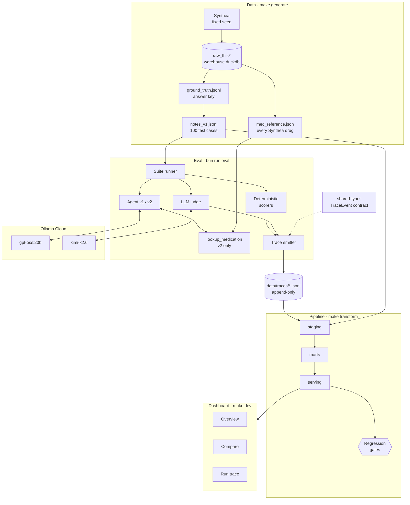

# ai_health_harness

An eval harness for an AI agent that summarises clinical notes. Synthetic patients from
Synthea become an answer key and 100 test-case notes with planted traps; each agent
version summarises every note, deterministic scorers and an LLM judge grade the
summaries, and a dbt pipeline turns the results into per-version rollups, regression
gates and a dashboard.

## How it fits together



Synthea patients become an answer key and 100 clinical notes. The runner sends each note
through an agent version, scores the summary against the answer key and with an LLM
judge, and appends one trace event per run. dbt turns the traces into per-version
rollups and fails the build when a version regresses. The dashboard reads only the
serving tables. `shared-types` holds the trace contract: the zod schema the emitter
validates against, and the JSON Schema the Python side and dbt are checked against.

| Folder | Language | What it holds |
|---|---|---|
| `data_processing/` | Python (uv) | Synthea, the ground truth, the test cases |
| `agent/` | TypeScript (bun) | The summariser under test and the model client |
| `harness/` | TypeScript (bun) | Suite runner, scorers, LLM judge, trace emitter |
| `shared-types/` | TypeScript (bun) | The trace event contract |
| `pipeline/` | dbt (Python) | Staging, marts, serving tables and regression gates |
| `dashboard/` | Next.js | Overview, version comparison and run traces |

## Quick start

Needs [uv](https://docs.astral.sh/uv/), [bun](https://bun.sh) and Docker (Synthea runs
in a Java container). Put an [Ollama Cloud](https://ollama.com/cloud) key in `.env` at
the repository root (see [Models](#models)), then run from the repository root:

| Command | What it does |
|---|---|
| `make all` | Everything from a fresh clone: install, build the data if not built yet, eval, pipeline |
| `make install` | Python and bun dependencies |
| `make generate` | Synthea → DuckDB → ground truth → test cases → drug reference |
| `make eval` | Every test case through the agent, then the pipeline and its regression gates |
| `make transform` | The pipeline alone |
| `make dev` | The dashboard on http://localhost:3000 |
| `make docs` | The dbt docs site |
| `make check` | Unit tests and typechecks, no model calls or data needed (what CI runs) |

The data steps can also run one at a time:

```
uv run --project data_processing ai-health-harness                # every step, in order
uv run --project data_processing ai-health-harness generate       # Synthea -> raw_fhir tables in DuckDB
uv run --project data_processing ai-health-harness ground-truth   # raw_fhir -> data/ground_truth.jsonl
uv run --project data_processing ai-health-harness notes          # ground truth -> datasets/notes_v1.jsonl
uv run --project data_processing ai-health-harness med-reference  # every Synthea drug -> data/med_reference.json
```

The seed, population size and Synthea version are pinned in
`data_processing/src/ai_health_harness/synthea.py`. Rerunning replaces the `raw_fhir`
schema; the same seed gives the same patients.

## FHIR resources

[FHIR](https://hl7.org/fhir/R4/) is the HL7 standard for exchanging health records: a
record is a set of typed *resources* that point at each other by reference. Synthea
can export about 25 resource types. This project loads six, the ones that describe a
patient's clinical state, because the summariser is judged on getting that state right:
its medications, allergies and conditions.

| Resource | Table | What it holds | Why it is here |
|---|---|---|---|
| Patient | `raw_fhir.patient` | Demographics, birth and death dates | The unit of a test case; everything else points at it |
| Encounter | `raw_fhir.encounter` | A visit: ambulatory, emergency, inpatient, ... | The context a note is written in; dates the other facts |
| Condition | `raw_fhir.condition` | A diagnosis with a clinical status (`active`, `resolved`) | Ground truth for active conditions |
| MedicationRequest | `raw_fhir.medication_request` | A prescription: drug, status, dose and timing | Ground truth for active medications with dose and frequency |
| AllergyIntolerance | `raw_fhir.allergy_intolerance` | An allergy or intolerance and its reactions | Ground truth for allergies, where a miss is a hard fail |
| Observation | `raw_fhir.observation` | Vitals, lab results, surveys, social history | Supporting detail a note mentions, and a source of distractors |

Left out on purpose:

- **Claim, ExplanationOfBenefit**: billing, which no summary needs.
- **DocumentReference, DiagnosticReport**: Synthea's own note text. The test-case notes
  are rendered from these records instead, so the traps planted in them are known.
- **Medication**: requests carry their drug inline (`medicationCodeableConcept`).
- **Organization, Practitioner, Location**: who and where, not what is wrong with
  the patient.
- **Immunization, Procedure, CarePlan, Device**: real history, but not in the ground
  truth, so including them would only add unscored noise for now.

Each one is a single setting away (`RESOURCES` in `synthea.py`).

Things worth knowing when querying:

- References are strings like `Patient/<id>`, so a join reads
  `ON c.subject.reference = 'Patient/' || p.id`.
- AllergyIntolerance points at its patient with `patient`, not `subject` like the
  other resources.
- Codes sit in lists of codings: `code.coding[1].display` (DuckDB lists start at 1).
- "Active" lives in different places: `clinicalStatus.coding[1].code` on Condition and
  AllergyIntolerance, `status` on MedicationRequest.
- Most prescriptions are `completed`; only a small share are `active`, and some active
  ones have no dose or timing (`dosageInstruction`). Most patients have no allergies.

```
uv run --project data_processing python -c "import duckdb; print(duckdb.connect('data/warehouse.duckdb').sql('SELECT count(*) FROM raw_fhir.medication_request'))"
```

## Ground truth

`data/ground_truth.jsonl` has one JSON record per living patient, as of the simulation
end date. Its shape is the contract in `schemas/ground_truth.schema.json`; every record
is validated against it when built.

- **medications**: active MedicationRequests with RxNorm code, dose, timing
  (`frequency` per `period` `period_unit`, so 2 per 1 d is twice daily) and whether the
  drug is taken as needed. Synthea leaves dose and timing out of many prescriptions;
  those fields are then `null`, and the drug is still listed.
- **allergies**: active AllergyIntolerances with their reactions.
- **conditions**: active Conditions, except the social and administrative entries
  Synthea also records as conditions (employment, education, housing, "medication
  review due", ...). The excluded codes are listed in `NON_CLINICAL` in
  `ground_truth.py`.

To check records by hand against the FHIR they came from:

```
uv run --project data_processing python -m ai_health_harness.ground_truth spot-check
```

It prints the same 10 patients each time, each record beside every active raw item,
with excluded conditions marked `[excluded]`.

## Test cases

`datasets/notes_v1.jsonl` holds 100 test cases, one JSON object per line:

| Field | What it holds |
|---|---|
| `case_id` | `v1-001` ... `v1-100` |
| `dataset_version` | `v1` |
| `patient_id` | The Synthea patient the case comes from |
| `categories` | Tags, below |
| `note` | The free-text note the summariser reads |
| `ground_truth` | The patient's ground-truth record, the answer key |

Patients are picked with the fixed seed, 40 of them with allergies so the allergy
traps get enough cases, and patients with no medications and no allergies are left
out. Notes are built from a template: HPI, past medical history, medications,
allergies, social history and plan. Every ground-truth item appears in its note.

The dataset is frozen. `datasets/` is gitignored, so each clone rebuilds it, and the
same seed gives the same cases. `ai-health-harness notes` refuses to overwrite an
existing file with different cases, so a change to how cases are picked or rendered
bumps `VERSION` in `notes.py`.

Some notes carry traps, tagged on the case:

- `discontinued_med`: a drug the patient stopped is named, and must not be summarised as current
- `buried_allergy`: no Allergies section; the allergies are mid-paragraph in social history
- `dose_change`: the med list shows the old dose; only the plan gives the current one
- `abbreviations`: BID, PRN, HTN, NKDA ... instead of words

Cases with no trap and at most 3 medications are tagged `simple`; 5 or more,
`polypharmacy`. In v1: simple 19, polypharmacy 26, discontinued_med 32,
buried_allergy 29, dose_change 18, abbreviations 32 (a case can carry several).

A note with `abbreviations` and `dose_change` (v1-006, shortened):

```
HPI: 75-year-old woman seen for a routine follow-up visit.

PMH: Anemia; obesity (BMI 30+); CKD 1; HTN; pre-DM; ...

Meds:
- Clopidogrel 75 MG Oral Tablet
- lisinopril 10 MG Oral Tablet, 2 tablets, QD

Allergies: NKDA

Plan: Decrease lisinopril 10 MG Oral Tablet to 1 tablet QD. Continue other medications.
```

The ground truth says 1 tablet, so a summary that copies the med list gets the dose wrong.

To read a case: `sed -n 6p datasets/notes_v1.jsonl | jq -r .note`

A local LLM pass to make the notes read more naturally is planned as dataset v2 (KAN-35).

## Models

The agent and the judge call models through one client, `modelClient` in
`agent/src/model.ts`. Ollama and most hosted providers speak the OpenAI
chat-completions API, so a provider is only a base URL in `models.json`, plus the
env var holding its key for hosted ones:

```json
"ollama-cloud": { "base_url": "https://ollama.com/v1", "api_key_env": "OLLAMA_API_KEY" },
"ollama": { "base_url": "http://localhost:11434/v1" }
```

A model is named `<provider>/<model>`, e.g. `ollama-cloud/gpt-oss:20b` or
`ollama/qwen3:8b`, so switching provider or model is a config change. Both the agent
and the judge run on [Ollama Cloud](https://ollama.com/cloud) by default, on models from
different families so the judge is not grading its own kind:

```json
"agent": "ollama-cloud/gpt-oss:20b",
"judge": "ollama-cloud/kimi-k2.6"
```

Put your key from ollama.com/settings/keys in a `.env` file at the repository root
(gitignored; bun loads it):

```
OLLAMA_API_KEY=...
```

Every call returns the text, input and output token counts (null if the provider leaves
them out), latency, and any tool calls the model asked for. Passing a zod schema puts it
in the system prompt with an instruction to reply in JSON only: Ollama Cloud ignores the
APIs' own structured-output options, so the caller still validates the reply. Failures
throw `ModelError`.

`agent/src/model.live.test.ts` makes one small call to each of the agent and judge
models, and skips when their key is not set (as in CI).

## Agent

The summariser (`agent/src/summarise.ts`) reads one note and returns a `Summary`:
a short narrative, plus the medications (name, dose, frequency), allergies (substance,
reactions) and active conditions. The `Summary` schema lives in `shared-types`.

```
bun run agent                 # the first 5 test cases
bun run agent v1-006 v1-012   # these cases
```

It prints each summary with its latency and token counts; to score runs, use the
[suite runner](#suite-runner). `summarise` never throws: a failed model call returns a
`model` error, and a reply that does not validate is retried once with the problem
pointed out, then returns a `parse` error with the last reply kept.

Agent versions live in `AGENTS` in `agent/src/summarise.ts`, each with its own prompt
and tools; the suite runner picks one with `--agent` (default 1):

| Agent | What it does |
|---|---|
| 1 | One model call: the note in, the summary out |
| 2 | Adds a `lookup_medication` tool (`agent/src/lookup.ts`): the model looks up each current medication as written, and gets back up to 3 standard names from every drug Synthea prescribes (`data/med_reference.json`), matched on letter trigrams so typos and brands still match. Every call is recorded in the trace |

`gpt-oss:20b` asks for one lookup per turn even when told to batch them, so v2 takes a
turn per medication: slower and several times the tokens. It may use up to 14 tool
turns (the longest medication list is 13); past that, calls are refused with an error
telling it to answer.

## Scorers

`harness/src/scorers.ts` holds the deterministic scorers: pure functions of a run's
summary and the case's ground truth, each giving one score for the trace event.
`scoreRun` returns them all. A run with no summary fails every one.

| Scorer | Value | Passes when |
|---|---|---|
| `schema_valid` | 1 if there is a summary | there is one |
| `medication_recall` | share of the patient's medications listed | none missed |
| `medication_precision` | share of listed medications on record | none extra (a stopped drug counts as extra) |
| `allergy_recall` | share of the patient's allergies listed | none missed |
| `dose_match` | share of listed medications with a recorded dose or timing that have both right | all right |
| `hallucinations` | share of listed medications and allergies on record | nothing made up |

How names, doses and frequencies are compared:

- Names match on their key words, ignoring packaging (Oral Tablet, ER, hydrochloride)
  and case, but any strength the summary gives must be on record: "Lisinopril",
  "lisinopril 10mg" and "Seasonique" all match their prescriptions; "lisinopril 20 mg"
  does not match a 10 MG one.
- Only the part of a name before the first comma is matched, since the agent sometimes
  copies the whole med-list line ("..., 2 tablets, QD") into it.
- A dose is right as a unit count ("1 tablet") or as the same amount by strength
  ("10 MG" for one 10 MG tablet).
- Frequencies are compared as times per day, so "BID" and "twice daily" agree.
- "NKDA", "None" or "Unknown" written as an allergy is ignored, and "Allergic
  disposition" is never expected, since it names no substance.
- Conditions are left to the LLM judge: "HTN" and "pre-DM" defeat string matching.

`harness/src/scorers.dataset.test.ts` checks the scorers on all 100 cases: restating
the ground truth scores full marks, and dropping any one item is caught.

### LLM judge

`harness/src/judge.ts` asks the judge model (`judge` in `models.json`) to grade each
summary from 1 to 5, with a rationale, on:

| Scorer | Grades |
|---|---|
| `judge_faithfulness` | everything in the summary is supported by the note; no stopped drug, stale dose or invention |
| `judge_usefulness` | a clinician could act on it at a glance |
| `judge_omissions` | nothing clinically important is missing, conditions included (HTN counts as hypertension) |

It sees the note, the patient's record and the summary. A grade of 4 or 5 passes; the
value is the grade scaled to 0–1, and the detail holds the grade and rationale. The
judge model and `JUDGE_PROMPT_VERSION` are written into every trace event, so a change to
the judge can be told apart from a change to the agent: bump the version whenever the
prompt or the rubric changes. Reasoning is turned off for the judge: `kimi-k2.6` reasons
for over a minute on this prompt, and Ollama Cloud drops a request after 60 seconds.

## Suite runner

```
bun run eval                       # every case in datasets/notes_v1.jsonl, as a new suite run
bun run eval --suite <id>          # resume a suite run: cases that already have an event are skipped
bun run eval --concurrency 2 --limit 10
bun run eval --skip-judge          # deterministic scorers only: faster, half the model calls
bun run eval --agent 2             # another agent version
```

`harness/src/suite.ts` runs each case through the agent (4 at a time by default),
scores it, has the judge grade it, and writes its trace event to
`data/traces/<suite_run_id>.jsonl`, printing a line per case and pass rates per scorer
at the end. Kill it at any point and rerun with the `--suite` id it printed to finish
the rest. Any event counts as done, a failed run included, so each suite run has one
event per case.

## Trace events

Each agent run on one test case produces one trace event: which agent, model and
prompt versions ran, the raw and parsed output, token counts, latency, tool calls,
a score per scorer, and any error. It is the contract between the TypeScript harness,
which writes events, and the Python pipeline, which reads them.

The zod schema in `shared-types/src/index.ts` is the source of truth; TypeScript code
imports `TraceEvent` from `shared-types`. `schemas/trace_event.schema.json` is generated
from it for the Python side: after changing the zod schema, run `make schema`. A
test fails while the two differ.

`emit` in `harness/src/traces.ts` validates each event and appends it as one line to
`data/traces/<suite_run_id>.jsonl`; an invalid event throws and writes nothing. These
files are the raw layer: lines are only ever appended, and DuckDB reads them directly,
`SELECT * FROM read_json('data/traces/*.jsonl')`. They are files rather than a table in
`warehouse.duckdb` because DuckDB lets only one process write a database file at a time.

## Pipeline

`pipeline/` is a dbt project (dbt-duckdb) over `data/warehouse.duckdb`. Run it from the
repository root:

```
make transform    # source freshness, every model, then every test (regression gates included)
make docs         # the dbt docs site, with every column described
```

The trace files must exist first: run `bun run eval` at least once.

### Staging

Sources read files in place: `raw.trace_events` is `data/traces/*.jsonl`,
`raw.test_cases` is `datasets/notes_*.jsonl`, and `raw_fhir.*` are the Synthea tables.

| Model | One row per |
|---|---|
| `stg_trace_events` | agent run: versions, tokens, latency, error, tool calls, outputs |
| `stg_trace_scores` | run and scorer (`score_id` is `<run_id>:<scorer>`) |
| `stg_test_cases` | test case: categories and item counts, note, ground truth |

Keys are tested unique and not null, every run's test case and every score's run must
exist, and freshness warns when no run was traced in 7 days.

### Marts

What to query:

| Model | One row per |
|---|---|
| `fct_scored_runs` | run: every score as a column, `passed`, keys to the dimensions; built incrementally |
| `dim_agent_version` | agent version, prompt version and model together (`agent_key`) |
| `dim_judge_version` | judge model and judge prompt version together (`judge_key`) |
| `dim_test_case` | test case and category, so a case with two tags has two rows |

Which categories did one agent version regress on, compared with another:

```sql
with by_category as (
    select d.category, f.agent_key, avg(f.passed::int) as pass_rate, count(*) as runs
    from marts.fct_scored_runs f
    join marts.dim_test_case d on d.case_id = f.test_case_id
    group by all
)
select after.category, before.pass_rate as before, after.pass_rate as after, after.runs
from by_category after
join by_category before using (category)
where before.agent_key = '1|1|ollama-cloud/gpt-oss:20b'
  and after.agent_key = '2|2|ollama-cloud/gpt-oss:20b'
  and after.pass_rate < before.pass_rate
order by after.pass_rate - before.pass_rate
```

### Serving

What the dashboard reads; it never queries the layers below. The tables are small (a
row per version, or per version and category or case), so the app queries them
directly:

| Model | One row per |
|---|---|
| `agg_version_summary` | agent version: pass rates, mean scores, p50/p95 latency, tokens |
| `agg_version_category` | agent version and test category, same metrics |
| `agg_version_case_result` | agent version and test case: the result in the version's latest suite run, its run id and failed scorers |
| `agg_version_case_diff` | agent version and test case: newly failing, newly passing, still passing or still failing against the predecessor |
| `agg_version_diff` | agent version and category against the predecessor: pass-rate change, cases newly failing and newly passing |
| `run_trace` | run: note, ground truth, output, every score with its detail, tool calls (for the trace view; query by `run_id`) |

A version's predecessor is the version that first ran just before it. The case diff
compares each version's latest suite run with its predecessor's, so rerunning a version
does not count a case twice; dbt unit tests in `pipeline/models/serving/schema.yml`
check that logic.

### Regression gates

```
make eval                                  # bun run eval, then make transform with the gates
make eval ARGS="--limit 10 --skip-judge"
```

Two dbt tests compare each agent version with its predecessor and fail the build:

- a category's deterministic pass rate drops by more than `max_category_drop`
  (`pipeline/dbt_project.yml`, 25 points)
- mean allergy recall drops at all

A failure logs a line naming what fell:

```
REGRESSION: deterministic_pass_rate in dose_change fell from 70.4% to 27.8% (allowed drop 25.0 points), agent 2|2|ollama-cloud/gpt-oss:20b vs 1|1|ollama-cloud/gpt-oss:20b
```

That one is agent v2, which copies the old dose from the med list it has just looked
up. `make transform` builds every model before running the tests, so a failing gate
still leaves the dashboard showing why.

The gate is coarse on purpose: one version's own suite runs differ by up to 22 points in
the smallest category (dose_change has 18 cases), and the judge's pass rate swings by
10, so the gate leaves the judge out and allows 25 points. Lower it once categories have
more cases or versions have several suite runs.

To throw away a run (a demo, a broken version), delete its trace file and rebuild from
scratch, since `fct_scored_runs` only ever adds rows:

```
uv run --project data_processing dbt build --full-refresh --project-dir pipeline --profiles-dir pipeline
```

## Dashboard

`dashboard/` is a Next.js app (App Router, TypeScript, Tailwind) over the serving tables.

```
make dev    # http://localhost:3000
```

Pages are server components that read `serving.*` through the DuckDB Node API
(`dashboard/lib/db.ts`); nothing in the browser touches the database. Each query opens a
read-only connection and closes it, because DuckDB will not let `make transform` write
while another process holds the file open, so the app can stay running through an eval.
Set `WAREHOUSE_PATH` to read a database other than `data/warehouse.duckdb`. Charts are
SVG rendered on the server, with hover tooltips.

| Page | What it shows |
|---|---|
| Overview (`/`) | Whether the latest version is better or worse than the previous one, headline tiles, pass rate across versions, pass rate by category, failing cases, every version |
| Compare (`/compare`) | Any two versions side by side: pass-rate change per category, test cases that newly fail and newly pass |
| Run trace (`/runs/<run_id>`) | One run: what went wrong, the note with record items highlighted, the record against the summary item by item, the judge's rationale, tokens, latency, tool calls |

**Overview.** The verdict says worse if allergy recall fell or the pass rate dropped 5
points or more, better if it rose 5 or more, and otherwise about the same, since one
version's own runs differ by that much. Tiles show pass rate, allergy recall, runs with
anything made up and p95 latency, each with its change. The category chart marks the
previous version with ticks and "was" labels; pick a version in the table to chart it.

**Compare.** Defaults to the latest version against its predecessor. Each flipped case
lists the scorers it failed on and links to both runs' traces. Cases are compared on
each version's latest suite run (`serving.agg_version_case_result`).

**Run trace.** Reached from a failing case on the overview or a flipped case on
Compare. Every allergy and medication on the record is highlighted in the note where it
appears: red if the summary missed it, blue if it found it. The found, missed and not
on record flags use the scorers' own matching (`alignment` in `harness/src/scorers.ts`),
so they always agree with the scores.
